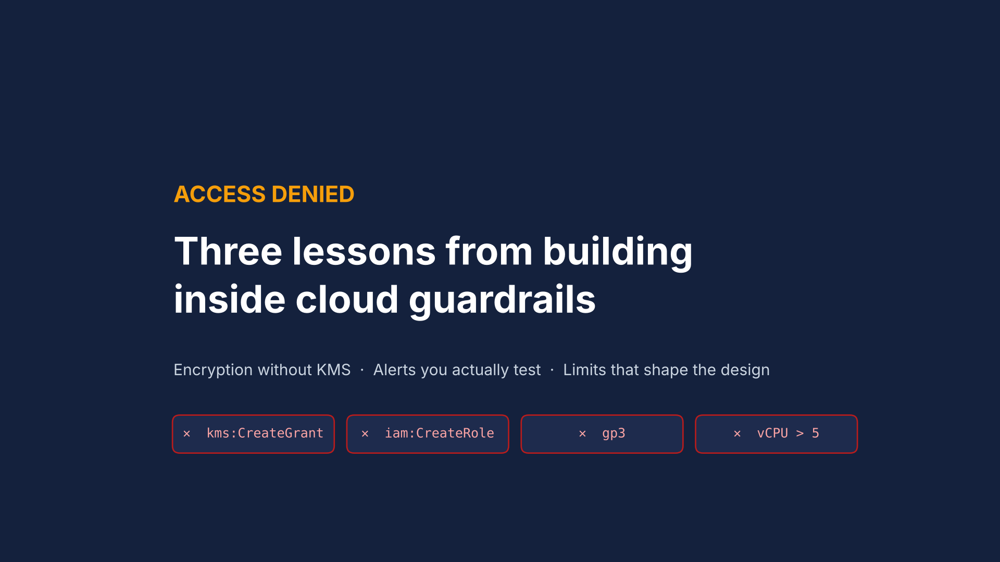
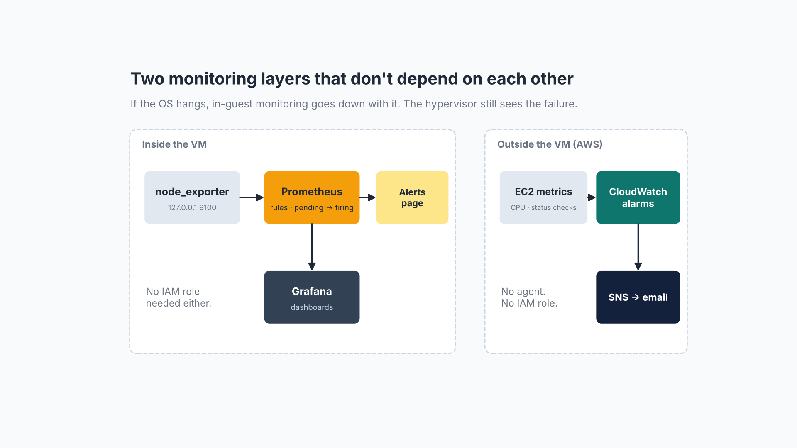

# Cloud Guardrails Homelab



A small, reproducible AWS build that shows how to keep security and observability standards when an account blocks the "easy" controls: no KMS keys, no IAM roles, strict instance and volume limits.

It covers three ideas:

1. **Encryption without KMS:** encrypt a dedicated data volume with LUKS2 (AES-256-XTS) and be clear about what that does and doesn't protect.
2. **Two independent monitoring layers:** Prometheus + Grafana inside the VM, and CloudWatch + SNS outside it, so one failing doesn't blind you.
3. **Alerts you've actually seen fire:** a repeatable CPU drill that proves both layers alert.

> **Note:** This is a personal learning project. It contains no course, assessment, or employer material, and it is not affiliated with or endorsed by any university or company.

## Architecture



| Component | Choice | Why |
|---|---|---|
| OS | Amazon Linux 2023 | Supported to 2029, version-locked repositories |
| Instance | 1 vCPU / 2 GiB burstable (Standard credits) | Fits a light web workload plus the monitoring stack |
| Storage | Root volume + separate data volume (gp2) | Sensitive data can be encrypted and retired on its own |
| Encryption | LUKS2, `aes-xts-plain64`, 512-bit key, Argon2id | Works when KMS is unavailable |
| Web | Apache httpd + mod_ssl (TLS 1.3) | Encryption in transit |
| In-guest monitoring | node_exporter, Prometheus, Grafana | No IAM role required |
| External monitoring | CloudWatch alarms → SNS email | Still alerts if the OS hangs |
| Access | EC2 Instance Connect, IMDSv2 required | No long-lived SSH keys |

## Repository layout

```
docs/       Write-ups and diagrams
scripts/    Setup and test scripts (run on Amazon Linux 2023 as ec2-user)
config/     Prometheus, Grafana, systemd and logging configuration
```

## Quick start

> Run these on a **test instance you own**. Read each script before running it. `luks-data-volume.sh` erases the target disk.

```bash
git clone https://github.com/ismele/cloud-guardrails-homelab.git
cd cloud-guardrails-homelab
sudo bash scripts/01-base-web.sh
sudo bash scripts/02-luks-data-volume.sh /dev/xvdb      # double-check the device name with lsblk first
sudo bash scripts/03-logging-baseline.sh
sudo bash scripts/04-install-monitoring.sh
sudo bash scripts/05-self-signed-tls.sh web.example.local
# from your workstation with the AWS CLI configured:
bash scripts/06-cloudwatch-alarms.sh <INSTANCE_ID> <your-email@example.com>
# prove the alerts work:
bash scripts/07-cpu-alert-drill.sh
```

## Docs

- [Encryption without KMS](docs/01-encryption-without-kms.md)
- [Two-layer monitoring](docs/02-two-layer-monitoring.md)
- [Testing alerts on purpose](docs/03-testing-alerts.md)
- [TLS on the web server](docs/04-tls.md)
- [Lessons learned](docs/05-lessons-learned.md)

## What I'd change in a normal production account

- EBS encryption with a customer managed KMS key, plus encryption by default for the Region
- CloudWatch agent under an instance role, so logs leave the server
- Load balancer with an AWS Certificate Manager certificate, and the web tier in a private subnet
- Security group rules that reference other security groups instead of IP addresses

## License

MIT
