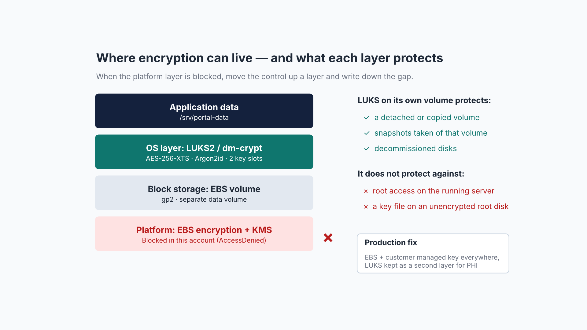

# Encryption without KMS



## The problem

The normal way to encrypt storage on AWS is EBS encryption, which uses AES-256 with a data key protected by KMS. In a locked-down account, the launch fails with an authorization error because the user can't use KMS keys, not even the AWS managed `aws/ebs` key.

## The approach

Move the control up one layer, into the operating system:

| Setting | Value | Why |
|---|---|---|
| Format | LUKS2 | Modern header, multiple key slots |
| Cipher | `aes-xts-plain64`, 512-bit key | XTS-AES is the NIST-approved mode for storage devices (SP 800-38E); 512 bits = two AES-256 keys |
| Key derivation | Argon2id | Memory-hard, makes passphrase brute force expensive (RFC 9106) |
| Primary key | 512 random bits, `/root/*.key`, mode 0400 | Only root can read it |
| Recovery | Second key slot with an offline passphrase | Losing the key file doesn't mean losing the data |
| Boot | `/etc/crypttab` by UUID + `/etc/fstab` with `nofail` | Unlocks automatically; a key problem can't block boot |
| Layout | Separate data volume | Encrypt, back up, and retire sensitive data independently |

Script: [`scripts/02-luks-data-volume.sh`](../scripts/02-luks-data-volume.sh)

## Verify

```bash
lsblk -f                         # data disk shows FSTYPE crypto_LUKS
sudo cryptsetup status data_crypt # type LUKS2, cipher aes-xts-plain64, keysize 512 bits
sudo cryptsetup luksDump /dev/xvdb | grep -E "Keyslots|luks2|Cipher|PBKDF"
```

## Be honest about the gap

| Protected | Not protected |
|---|---|
| A detached or copied data volume | Someone with root on the running server |
| Snapshots of that volume | A key file stored on an unencrypted root disk |
| Decommissioned disks | |

In a normal account: EBS encryption with a customer managed KMS key on every volume, encryption by default for the Region, and LUKS kept as a second layer only where the data justifies it, with its key held outside the disk.
