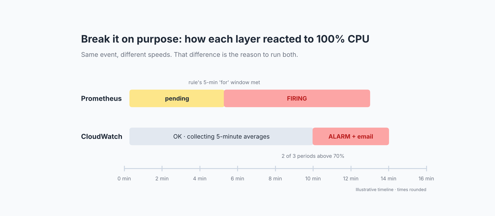

# Testing alerts on purpose



An alert you've never seen fire is an assumption. Run a drill:

```bash
bash scripts/07-cpu-alert-drill.sh 480   # 8 minutes at 100% on every core
```

## What to expect

| Layer | Behavior |
|---|---|
| Prometheus | `HighCpu` goes **pending** almost immediately and **firing** once the 5-minute `for:` window is met |
| CloudWatch | Stays OK while it collects 5-minute averages, then moves to **ALARM** after 2 of 3 periods exceed 70%, and SNS emails you |

Same event, different speeds. Fast in-guest alerting and slower external alerting aren't duplicates; they cover different failures.

On burstable instances with Standard credits, sustained load may get throttled once credits run out, which lowers the CloudWatch average. That's expected and worth knowing before you set thresholds.

## Quick health checks

From another host in the same network:

```powershell
ping -n 20 <private-ip>
Test-NetConnection <private-ip> -Port 443
Measure-Command { Invoke-WebRequest http://<private-ip> -UseBasicParsing }
```

For load, a simple Apache JMeter plan (a Thread Group with 20 threads and an HTTP Request to `/`) is enough to watch response times and error rate in the Summary Report while the Grafana dashboard shows the traffic. Run the first request twice. The first run includes one-time connection costs on the client.
